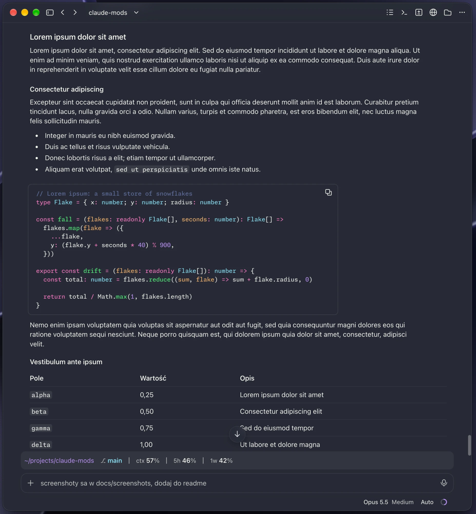
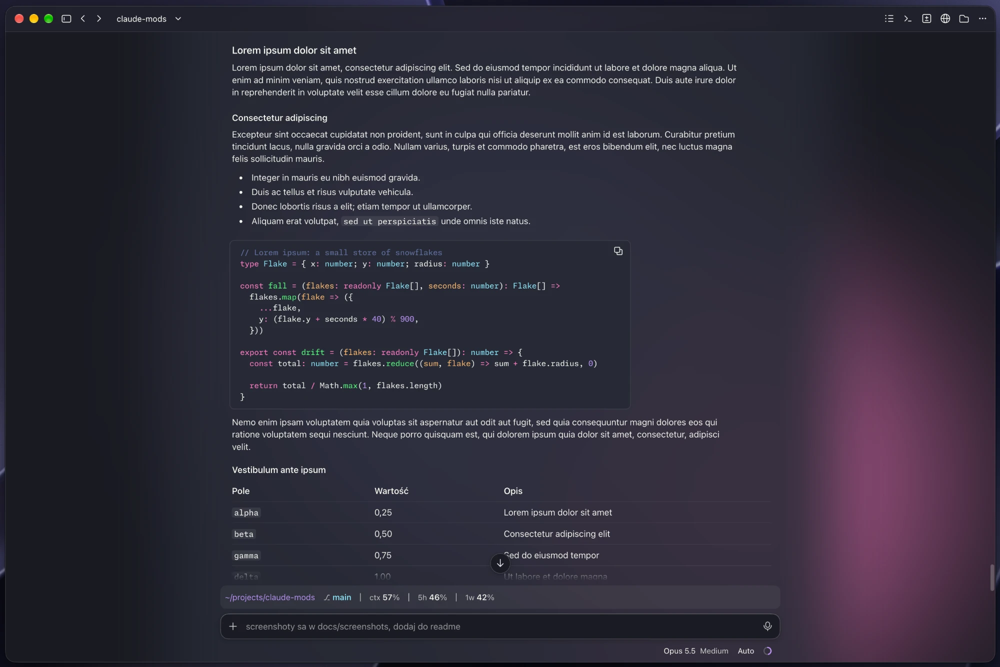
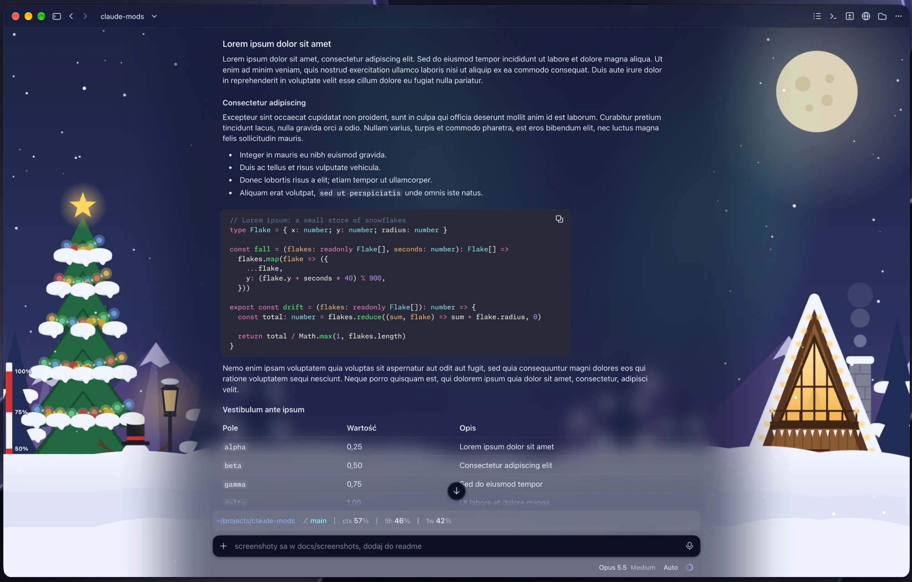

# claude-mods

Mods for the Claude desktop app.

| Theme                                                | Dark                                      | Light   | Animated                         | Screenshot                                                                                                                                                                                                      |
| ---------------------------------------------------- | ----------------------------------------- | ------- | -------------------------------- | --------------------------------------------------------------------------------------------------------------------------------------------------------------------------------------------------------------- |
| [`dracula-theme`](plugins/dracula-theme)             | Dracula                                   | Alucard | no                               | <a href="docs/screenshots/dracula-theme.webp" target="_blank"></a>                                 |
| [`dracula-scene-theme`](plugins/dracula-scene-theme) | Dracula + scene                           | none    | yes: drifting glows              | <a href="docs/screenshots/dracula-scene-theme.webp" target="_blank"></a> |
| [`christmas-theme`](plugins/christmas-theme)         | Snowy night; snow rises with the 5h limit | none    | yes: falling snow, rising drifts | <a href="docs/screenshots/christmas-theme.webp" target="_blank"></a>   |

| Mod                                    | What it shows above the prompt                                       |
| -------------------------------------- | -------------------------------------------------------------------- |
| [`session-band`](plugins/session-band) | `~/folder ⎇ branch │ +347 -5 │ ctx 64% │ 5h 16% │ 1w 30% │ agents 2` |

## Install

Desktop app: **+** → **Plugins** → add marketplace `twistezo/claude-mods` → add one theme and any other mods → new session.

## Update

```bash
# <mod>: dracula-theme, dracula-scene-theme, christmas-theme or session-band; repeat the update for each installed mod
claude plugin marketplace update claude-mods && claude plugin update <mod>@claude-mods
```

## License

- [MIT](LICENSE)
- Colors: [Dracula Theme](https://draculatheme.com).
- `christmas-theme`: based on Lydia Hallie's [snow-as-context demo](https://x.com/lydiahallie/status/2122028598639136810).
